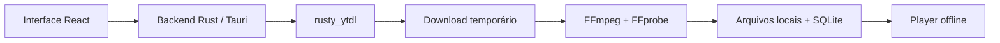

# LOCAL

**Sua música, no seu ritmo.**

Aplicativo desktop para baixar músicas e vídeos do YouTube e reproduzir offline. Construído com **Tauri 2, Rust, React e TypeScript**, com biblioteca local em SQLite e sem servidor remoto, conta ou sincronização.

> **v0.1.0 — primeira versão experimental.** O desktop foi validado em macOS Apple Silicon. O aplicativo Expo existente está preservado, mas não recebe o fluxo de downloads nesta versão.

## Funcionalidades

- Adição por link do YouTube, YouTube Music, Shorts ou `youtu.be`, com prévia de título, canal, duração e capa.
- Download de áudio **M4A/AAC** ou vídeo **MP4/H.264/AAC**, até 1080p.
- Fila persistente com progresso real de bytes, cancelamento e nova tentativa.
- Processamento e validação dos arquivos antes de disponibilizá-los na biblioteca.
- Busca por título, artista e álbum, favoritos e gerenciamento de playlists.
- Player com fila, volume, busca de posição, modo aleatório e repetição.
- Reprodução local de vídeo e restauração pausada da sessão ao reabrir.
- Biblioteca inicialmente vazia, sem músicas ou playlists de demonstração.

A importação de arquivos do computador não faz parte do fluxo atual. Baixe apenas conteúdo que você tem autorização para salvar.

## Como funciona



O download acontece no backend Rust usando `rusty_ytdl`. FFmpeg converte os arquivos e FFprobe valida a mídia finalizada. O aplicativo empacotado inclui os dois executáveis e não busca ferramentas no PATH: o usuário final não precisa instalar yt-dlp, Python, Node.js, Deno ou Homebrew.

## Desenvolvimento

### Pré-requisitos

- macOS Apple Silicon para o desktop desta versão.
- Node.js **22.12+** e npm **11+**.
- Rust estável e Xcode Command Line Tools, conforme os [pré-requisitos do Tauri](https://v2.tauri.app/start/prerequisites/).
- Python 3 e `curl` apenas para preparar os binários durante o desenvolvimento.

### Instalação

```sh
git clone https://github.com/pedroaba/ydown.git
cd ydown
npm ci
python3 scripts/fetch-media-tools.py
npm run desktop
```

`npm run desktop` abre a janela nativa. O primeiro build baixa e compila as dependências Rust. O workspace usa npm e mantém `package-lock.json` e `Cargo.lock` versionados.

Os executáveis de mídia **não são armazenados no histórico Git**. O script de preparação baixa versões fixas e verifica SHA-256 dos arquivos ZIP e dos executáveis usando o [manifesto](apps/desktop/src-tauri/binaries/manifest.json). Os binários ficam dentro do projeto local e são incorporados ao aplicativo no build; não há download de ferramentas durante a execução do `.app`.

### Comandos

| Comando                   | Função                                                    |
| ------------------------- | --------------------------------------------------------- |
| `npm run desktop`         | Iniciar o aplicativo Tauri em desenvolvimento             |
| `npm run desktop:preview` | Servir apenas a interface; download requer a janela Tauri |
| `npm run check`           | TypeScript, testes e build da interface                   |
| `npm run format:check`    | Conferir formatação                                       |
| `npm run desktop:build`   | Gerar os bundles macOS configurados, `.app` e `.dmg`      |
| `npm run mobile`          | Iniciar o aplicativo Expo existente                       |

## Gerar o aplicativo macOS

```sh
python3 scripts/fetch-media-tools.py
npm run bundle -w @ydown/desktop -- --bundles app
```

Saída: `apps/desktop/src-tauri/target/release/bundle/macos/LOCAL.app`.

O pacote contém FFmpeg e FFprobe **9.0.2**, para `aarch64-apple-darwin`. Os executáveis vêm do [provedor Martin Riedl](https://ffmpeg.martin-riedl.de/) e usam apenas bibliotecas do sistema macOS. A origem, os hashes e os avisos de terceiros estão em [binaries/](apps/desktop/src-tauri/binaries/README.md).

Assinatura e notarização para distribuição pública não estão configuradas. Este repositório publica o código-fonte e os scripts de preparação; não fornece instaladores nem executáveis de terceiros no histórico Git. Antes de distribuir instaladores, revise as licenças dos componentes incluídos. Windows, Linux e Mac Intel exigem binários próprios e configuração de plataforma adicional.

## Uso

1. Abra **Adicionar música** e cole um link HTTPS de vídeo do YouTube.
2. Clique em **Buscar vídeo** e confira a prévia.
3. Escolha **Áudio** ou **Vídeo** e clique em **Baixar do YouTube**.
4. Acompanhe o andamento em **Downloads**.
5. Após finalizar e validar o arquivo, reproduza pela biblioteca. Para vídeos, use **Assistir ao vídeo** no player.

O progresso representa bytes recebidos; processamento e validação aparecem como uma etapa separada. Os jobs são processados um por vez e deduplicados por ID do vídeo e tipo de mídia. Links com parâmetros de playlist são normalizados para o vídeo indicado, sem baixar a playlist inteira.

## Estrutura

```text
apps/
  desktop/              # React, adaptadores e backend Tauri/Rust
  mobile/               # Aplicativo Expo existente
packages/
  core/                 # Entidades e regras de domínio
  contracts/            # Contratos de serviços e aquisição de mídia
  state/                # Estado, casos de uso e persistência por contratos
  hooks/                # Integração React
  design-tokens/        # Tokens visuais
  ui-desktop/           # Componentes DOM/Radix
  ui-mobile/            # Componentes React Native
  utils/                # Utilitários compartilhados
scripts/                # Preparação dos binários de mídia
tests/                  # Testes de domínio e arquitetura
```

O mobile permanece separado e sem alterações nesta etapa. Seus adaptadores não usam os binários de desktop, e downloads não foram portados para Android/iOS.

## Dados locais

O aplicativo usa o App Data de `com.local.music`. No macOS, a pasta padrão é `~/Library/Application Support/com.local.music/`:

- `library.sqlite3`: documentos de biblioteca/sessão em `app_state` e jobs em `download_jobs`.
- `audio/`: áudio, vídeo e capas finalizados.
- `downloads/`: arquivos temporários de aquisição e processamento.

As referências persistidas são relativas, no formato `local:<id>.<ext>`. O protocolo asset permite acesso somente à pasta de mídia do aplicativo. As capas baixadas são locais; a prévia usa o domínio de imagens do YouTube.

Jobs incompletos são marcados como interrompidos ao reiniciar e podem ser tentados novamente. O player restaura a sessão pausada, sem autoplay. Dados de execução, bancos, backups, mídia baixada, builds e credenciais não pertencem ao repositório e são excluídos pelo `.gitignore`.

## Verificação

```sh
npm run check
npm run format:check
cargo test --manifest-path apps/desktop/src-tauri/Cargo.toml --lib
cargo fmt --manifest-path apps/desktop/src-tauri/Cargo.toml -- --check
```

Há também uma prova de extração e download real, sem adicionar conteúdo à biblioteca:

```sh
cargo run --manifest-path apps/desktop/src-tauri/Cargo.toml \
  --example youtube_probe -- 'https://www.youtube.com/watch?v=jNQXAC9IVRw'
```

A validação da primeira versão incluiu **19 testes TypeScript**, **três testes Rust**, download real de M4A e MP4 e reprodução do vídeo local pelo aplicativo empacotado. Detalhes e limites estão em [docs/verification.md](docs/verification.md).

## Limitações conhecidas

- O `rusty_ytdl` está fixado na revisão oficial `b1c6eb7c83f0d6189f256ed5df50019a5803c734`. A versão do crates.io não forneceu URLs utilizáveis nos testes; a revisão Git corrigiu esse caso. O pin `idna_adapter=1.2.1` mantém compatibilidade entre as dependências IDNA, Boa e ICU.
- Mudanças do YouTube ou rejeições de rede podem impedir a extração de determinados vídeos. Os erros são mostrados na interface; não há fallback para yt-dlp nem sucesso simulado.
- Live, conteúdo privado ou com restrição de idade e playlists inteiras não são suportados. Não são usados cookies, proxies ou mecanismos para contornar controles de acesso.
- Quotas de disco, retomada de bytes, histórico de reprodução, reordenação manual, mudança de pasta e limpeza geral de arquivos órfãos permanecem pendentes.
- Um encerramento abrupto pode deixar temporários/órfãos e perder aproximadamente os últimos dois segundos de posição do player.
